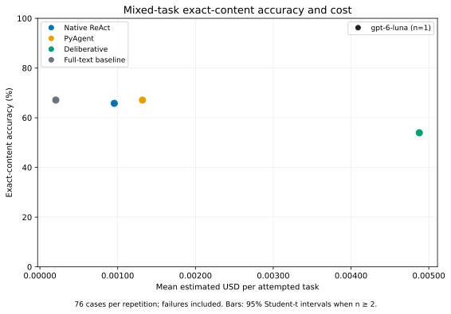

# M3 comparison results

Complete repetitions shared by all methods within each model: `gpt-6-luna`: [1, 4, 5].



[Machine-readable results and provenance](results.json) · [PNG figure](accuracy-cost.png)

Accuracy counts exact QASPER answers (normalized F1 = 1), correct expert labels and controlled verdicts, and acceptable selection/abstention over 76 tasks (20/20/24/12). Cases weigh equally; failures score zero. This descriptive aggregate does not establish overall review usefulness.

26 development cases were excluded; test groups are disjoint by paper, study family or candidate set.

Models remain separate; attempts per method equal 76 × included repetitions.

| Method | gpt-6-luna: accuracy (%) | gpt-6-luna: USD/task |
|---|---:|---:|
| Native ReAct | 58.77 [43.67, 73.87] | 0.000836 [0.000574, 0.001097] |
| PyAgent | 65.79 [60.13, 71.45] | 0.001225 [0.001020, 0.001430] |
| Deliberative | 53.07 [51.18, 54.96] | 0.005095 [0.004511, 0.005680] |
| Full-text baseline | 70.18 [65.18, 75.17] | 0.000204 [0.000201, 0.000206] |

Brackets/error bars are untruncated 95% Student-t intervals across complete repetition means; n=1 has none. Costs include failures and retries; unknowns stay unknown. Incomplete rounds are excluded. Intervals describe run variation on these fixed tasks.

JSON retains per-track F1/pair metrics, M2 completion/citations, source hashes and timing. Separate source/scheduling blocks and later deliberative starts prevent controlled latency comparisons. API/protocol failures also lower accuracy; this aggregate cannot isolate scientific reasoning quality.

Rebuild offline from the repository root after installing `requirements-report.txt`:

```shell
python scripts/report_m3_results.py runs/m3-final-agent-20261118-luna6 runs/m3-final-pyagent_react-20261118-luna6 runs/m3-final-deliberative_review-20261118-luna6 runs/m3-final-baseline-recovery-20261118-luna6 runs/m3-final-extra-r4-20261118-luna6 runs/m3-final-extra-r5-20261118-luna6 --out milestones/M3-results
```
