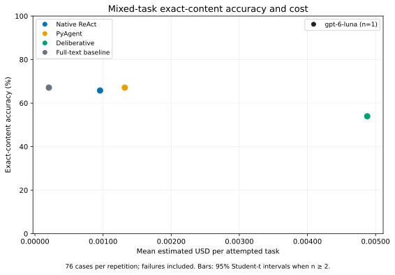

# M3: comparing paper-assessment agents

The task is evidence-backed paper assessment for a reading club. M1's performance
measure is defensible research and discussion value, reliable execution and
acceptable cost. Three agents and one baseline share the `paper-review` entry point.

| Method | Mechanism and hypothesis | Source |
|---|---|---|
| `agent` | Native function-calling ReAct with full interaction history; reference condition. | [M2](M2.md), [ReAct](https://arxiv.org/abs/2210.03629). |
| `pyagent_react` | Imported ReAct harness with text actions; preserve verified completion without increasing cost. | [PyAgent hypothesis and source](../variants/pyagent_react/README.md). |
| `deliberative_review` | Plan, investigate, draft, criticize in a fresh context, then revise; reduce missed counterevidence and scope errors. | [Hypothesis and sources](../variants/deliberative_review/README.md). |
| `baseline` | Full paper in one structured-output call; reference for complete-evidence accuracy and cost. | [M2](M2.md). |

## Benchmark and comparison

The [frozen benchmark](benchmark-protocol.md) contains 26 development and 76 test
cases: 20 QASPER scientific questions, 20 ReviewCritique review segments,
24 controlled claim judgments, and 12 selections under explicit club briefs.
QASPER supplies answers and evidence; ReviewCritique supplies expert
reliability labels. Controlled studies and selection policies have programmatic
references. Paper groups, scientific families and candidate sets stay within one
split; development cases are excluded from test results. Reference labels never
enter agent requests.

Metrics separate answer/evidence F1, critique macro-F1, controlled pair accuracy,
and acceptable selections. Shared rounds 1, 2, 4 and 5 give 304 attempts per method:
native 58.55% exact correctness ($0.000821/task), PyAgent 66.45% ($0.001232),
deliberative 53.95% ($0.005108), baseline 70.07% ($0.000203). Failures count as
incorrect; figure intervals describe variation across four repetitions.

Collection uses `gpt-6-luna` and targets up to five benchmark repetitions.
Base method blocks include M2; extra rounds skip it. Reading caps are five for core/M2
and 20 for selection. Ordinary decision caps are 16 and 46, followed, if needed,
by one forced final answer call without tools or retries. Ordinary submissions
retain citation acceptance; valid non-null forced answers complete with separate
citation diagnostics. Null or failed final calls remain failures. Only complete
comparable repetitions enter the [generated results](M3-results/README.md).

The unchanged 20-paper M2 [appendix](M3-results/M2.md) retains completion,
citations, calls, tokens, cost, latency, per-paper results, pass^k and paired intervals.

## What the failures reveal

Two preliminary expert-labelled cases expose coverage and interpretation errors.
For [RC-f94db276afa4](../data/benchmark/v1/reviewcritique/references/RC-f94db276afa4.json),
the native agent misses an already-reported KALM ablation. The baseline cites that
ablation yet accepts the reviewer's request because it is phrased as a question.
Both outputs have verified quotations; the expert label is `deficient`.

For [RC-f5097b168055](../data/benchmark/v1/reviewcritique/references/RC-f5097b168055.json),
the baseline treats possible explanations as sufficient analysis. The review
already acknowledges those possibilities and asks for evidence distinguishing
them; experts label that criticism `reliable`. Plausible discussion does not
establish an explanation. The [failure map](failure-map.md) links original traces
and revisits every M1 risk. The [final-policy T17 diagnostic](../runs/m3-t17-final-r10/README.md)
completed ten attempts with verified citations; none needed forced finalization.
Seven used more than eight decisions; citation repair often needed
capacity beyond the earlier cap. This diagnostic remains separate from benchmark accuracy.

## Selection

Full-source inputs fit the baseline's context. Reading agents instead pay for
evidence acquisition and repeated history, with capped source access; deliberation
adds planning and criticism calls. These mechanisms have not earned their cost
here. The experiment demonstrates no benefit from the added agent complexity.

The baseline wins this benchmark: highest content accuracy at about one sixth
of PyAgent's cost favors the tested components of M1's evidence-backed assessment
value. Content pass^1/pass^4 are 0.701/0.645; M2 verified pass^1/pass^2 are
0.45/0.25, an important citation weakness. Its 3.62-point lead over PyAgent is below
PyAgent's 5.26-point repetition range; their intervals overlap.
